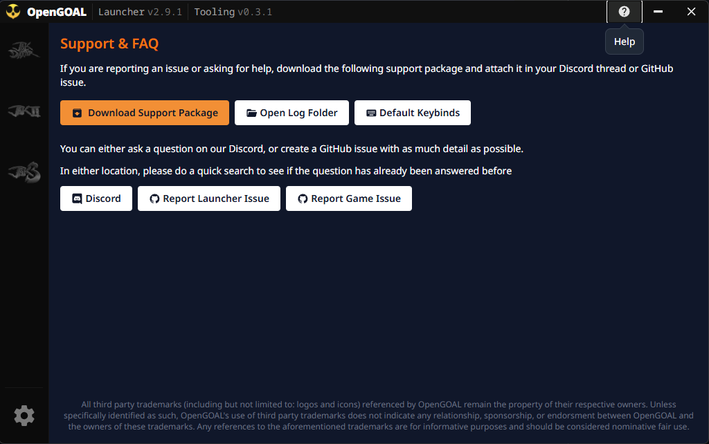

# OpenGOAL Launcher

[](https://crowdin.com/project/opengoal-launcher)

A cross-platform launcher for [OpenGOAL](https://github.com/open-goal/jak-project) that makes installing and updating games simple, with built-in support for mods and texture packs.

- [Usage](#usage)
- [Getting help](#getting-help)
- [Development](#development)
  - [Prerequisites](#prerequisites)
  - [Building and Running Locally](#building-and-running-locally)

## Usage

Follow the [installation and usage guide](https://opengoal.dev/docs/usage/installation/) to get started.

## Getting Help

When reporting a problem, describe what happened and include a support package. The support package contains logs that help us diagnose the issue.



If the launcher will not open or cannot create a support package, attach the logs from the folder for your operating system. These paths include folders that are hidden by default.

| Operating System | Log Directory                                                     |
| ---------------- | ----------------------------------------------------------------- |
| Windows          | C://Users/<YOUR_USER_NAME>/AppData/Roaming/OpenGOAL-Launcher/logs |
| Linux            | /home/<YOUR_USER_NAME>/.config/OpenGOAL-Launcher/logs             |
| macOS            | /Users/<YOUR_USER_NAME>/Library/Logs/OpenGOAL-Launcher/app/logs   |

## Development

The launcher is built with [Tauri v2](https://tauri.app/) and [Svelte 5](https://svelte.dev/).

### Prerequisites

Install the following:

- [Rust](https://www.rust-lang.org/tools/install)
- [Node.js (LTS)](https://nodejs.org/)
- [Tauri system dependencies](https://v2.tauri.app/start/prerequisites/#system-dependencies) for your operating system
- Yarn: `npm install -g yarn`

### Building and Running Locally

From the repository root, install dependencies and start the launcher:

```bash
yarn install
yarn tauri dev
```

<!-- https://www.pwabuilder.com/imageGenerator for generating icons (removed tauricon )-->
